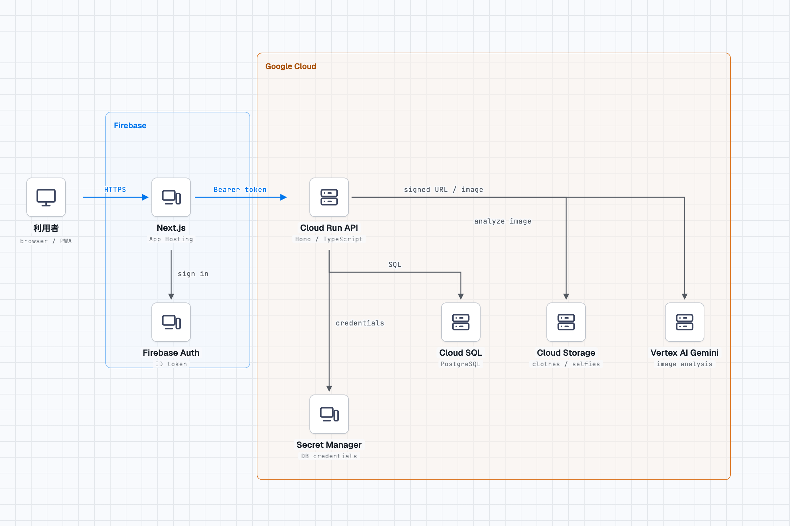

# AI Closet

> 画像解析で「持っている服」を資産に変える、次世代スタイリング・ログ

AI Closet は、手持ちの服をデジタルなクローゼットとして管理し、日々の着用を記録・振り返る Web アプリです。服や着用写真を AI が解析し、登録済みのアイテムから候補を提示します。着用傾向の可視化、天気に合わせたコーデ提案、クローゼットについて相談できるチャット、バーチャル試着も提供します。

## デプロイ先

https://devfest-513813.web.app/

## 主な機能

- Firebase Authentication によるメールアドレス認証
- 服の写真・属性を登録するマイクローゼット
- 自撮りから着用アイテムを解析し、クローゼット内の候補を提示する着用記録
- カレンダーでの着用履歴の確認と、色・カテゴリ別の利用傾向の集計
- 居住地の天気を考慮した、手持ち服からのコーディネート提案
- クローゼットと直近の着用履歴を文脈にした AI チャット
- 人物写真と服画像を用いたバーチャル試着イメージの生成
- プロフィール（表示名・年齢・居住地）の管理

## アーキテクチャ



1. ブラウザの Next.js PWA が Firebase Authentication でログインし、ID トークンを取得します。
2. フロントエンドはトークンを付与して Cloud Run 上の Hono API を呼び出します。
3. API は Firebase ID トークンを検証し、ユーザー本人のデータだけを Cloud SQL for PostgreSQL から読み書きします。
4. 服・自撮り・プロフィール画像は Cloud Storage に保存します。アップロードおよび表示には API が発行する期限付き URL を使います。
5. Vertex AI Gemini が画像解析、コーディネート提案、チャット、バーチャル試着を支援します。
6. Cloud Run の接続情報などの機密値は Secret Manager で管理します。

## 技術スタック

| 領域 | 技術 |
| --- | --- |
| フロントエンド | Next.js 15 / React 19 / TypeScript |
| フロントエンド公開 | Firebase Hosting |
| 認証 | Firebase Authentication |
| API | Cloud Run / Hono / TypeScript |
| データベース | Cloud SQL for PostgreSQL |
| 画像ストレージ | Cloud Storage |
| AI | Vertex AI Gemini (`@google/genai`) |
| 入力検証・共有型 | Zod / `packages/shared` |

## リポジトリ構成

```text
apps/
  web/                 Next.js フロントエンド
  api/                 Cloud Run 向け Hono API
packages/
  shared/              フロントエンド・API間の共有スキーマ
infra/
  database/            Cloud SQL の初期スキーマ
  storage/             Cloud Storage の CORS 設定
  cloudbuild.api.yaml  API コンテナのビルド定義
docs/                  要件・設計資料・アーキテクチャ図
```

## ローカル開発

Node.js 22 以降を用意し、依存関係をインストールします。

```bash
npm install
```

環境変数の雛形をコピーして、それぞれの値を設定します。認証情報や API キーはリポジトリにコミットしないでください。

```bash
cp apps/web/.env.example apps/web/.env.local
cp apps/api/.env.example apps/api/.env
```

別々のターミナルでフロントエンドと API を起動します。

```bash
npm run dev:web
npm run dev:api
```

型チェックとビルドは次で実行できます。

```bash
npm run typecheck
npm run build
```

## デプロイ

フロントエンドは静的エクスポートを Firebase Hosting に公開します。

```bash
npm run deploy:web
```

API は `apps/api/Dockerfile` と `infra/cloudbuild.api.yaml` を使ってコンテナ化し、Cloud Run へデプロイします。Cloud SQL、Cloud Storage、Vertex AI、Secret Manager の設定手順は [docs/GCP_SETUP.md](docs/GCP_SETUP.md) を参照してください。

## セキュリティとプライバシー

- API は Firebase ID トークンを検証し、ユーザー ID をサーバー側で確定します。
- 画像オブジェクトのパスはユーザーごとに分離し、API で所有権を検証します。
- 画像のアップロード・閲覧は短時間で失効する署名 URL を利用します。
- DB 接続情報、API キーなどの機密値は環境変数または Secret Manager で管理し、コミットしません。

## ライセンス

[MIT License](LICENSE)
